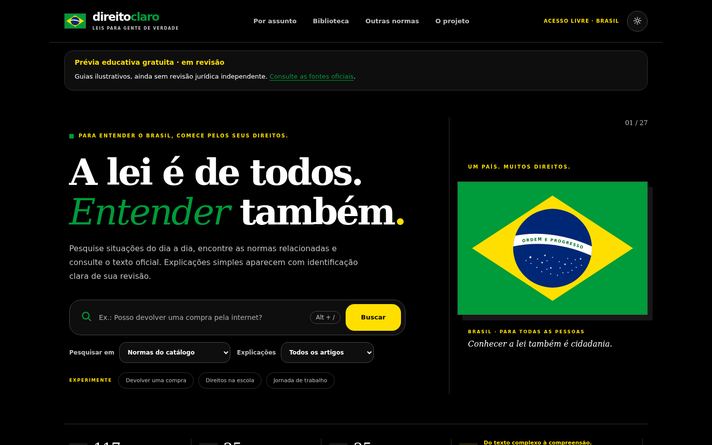
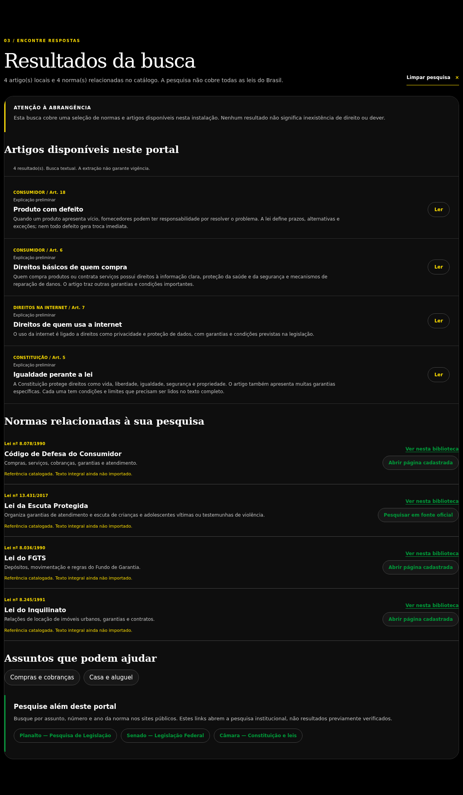

# Direito Claro

Portal gratuito para pesquisar normas brasileiras, consultar fontes oficiais e entender situações do dia a dia.

**Prévia educativa v0.25.0, ainda em revisão.** São 117 referências e 25 guias ilustrativos, sem revisão jurídica independente. Nenhum artigo oficial foi publicado no portal. O conteúdo não substitui orientação jurídica; a liberação de produção permanece **NO_GO**.

Acesse: [direito.securityops.co](https://direito.securityops.co) · [direito.securityops.com.br](https://direito.securityops.com.br)



A busca localiza os guias disponíveis e indica normas e fontes relacionadas. Exemplo real de pesquisa por “garantia”:



A seção **Links úteis** reúne serviços públicos para agir: BC PROTEGE+, Registrato, Celular Seguro, Consumidor.gov.br, ANS, Anatel, Meu INSS, Receita Federal, Fala.BR, Portal da Transparência e Gov.br. Os links abrem o site oficial de cada serviço, sem troca de dados com este portal.

## Executar localmente

Requer Python 3.12 ou superior, com SQLite FTS5. Execute na raiz do projeto:

```sh
python3 -m venv .venv
. .venv/bin/activate
python -m pip install --require-hashes -r requirements-bootstrap.lock
python -m pip install --require-hashes -r requirements-public.lock
mkdir -p local-data public-data
DIREITO_DATABASE="$PWD/local-data/seed.sqlite3" python -c 'from app.storage import connect, setup; from contextlib import closing; c=connect(); setup(c); c.close()'
python -m scripts.export_public_snapshot \
  --private-db local-data/seed.sqlite3 \
  --output public-data/public.sqlite3 --nonproduction
chmod 444 public-data/public.sqlite3
DIREITO_PUBLIC_READ_ONLY=1 DIREITO_DEPLOYMENT_MODE=staging \
DIREITO_DATABASE="$PWD/public-data/public.sqlite3" \
  python -m uvicorn app.main:app --host 127.0.0.1 --port 8080 --no-access-log
```

Abra `http://127.0.0.1:8080`. A exportação exige destino inexistente. O banco inicial contém apenas o catálogo e exemplos distribuídos com o código; mantenha bases de revisão e suas chaves fora do servidor web.

## Deploy da prévia pública

1. Prepare um CT sem privilégios, usuário dedicado e diretórios de versão imutáveis. Instale as dependências fixadas acima e monte somente o snapshot público como leitura.
2. Execute o servidor em `127.0.0.1:8080`, com as três variáveis `DIREITO_*` acima. Configure systemd para reiniciar o serviço, limitar memória/processos e impedir ganho de privilégios; use sistema de arquivos somente leitura e diretório temporário privado.
3. Configure os domínios no proxy HTTPS, certificado válido e renovação automática. Encaminhe somente GET/HEAD ao portal; aplique limites de requisições, conexões, tamanho e tempo. Mantenha SSH e administração fora do acesso público.
4. Verifique página, busca, aviso de revisão, `/api/ready` e `/api/release-status`. Caminhos privados, banco de dados e `.git` devem retornar 403/404. Preserve uma versão anterior validada para rollback.

O serviço pode oferecer a **prévia gratuita sem cadastro** com `staging`; isso não altera o aceite jurídico e operacional. `production` é recusado nesta candidata. Consulte o [guia de deploy e recuperação](docs/DEPLOYMENT_0.25.0.en.md), o [relatório de segurança](docs/VULNERABILITY_REPORT_0.25.0.md) e o [checklist](docs/PRODUCTION_CHECKLIST_0.25.0.md). Nenhuma configuração garante ausência de ataques.

Instruções completas de instalação e exemplos de systemd e Nginx estão no [guia de hospedagem](docs/PUBLIC_HOSTING_0.25.0.en.md).

## Testes e integridade

```sh
python -m pip install -r requirements-verification.txt
python -m pytest -q
sha256sum -c SHA256SUMS
```

Resultado observado: **301 testes aprovados**, com um aviso de depreciação. Os recibos técnicos e os limites da verificação estão em [QA](docs/QA_REPORT_0.25.0.md). Avaliação manual de acessibilidade, revisão profissional e aceite dos riscos residuais continuam pendentes.

## Código e licença

[SecurityOps .com.br](https://git.securityops.com.br/cristiancmoises/direitoclaro) · [SecurityOps .co](https://git.securityops.co/cristiancmoises/direitoclaro) · [GitHub](https://github.com/cristiancmoises/direitoclaro) · [Codeberg](https://codeberg.org/berkeley/direitoclaro)

Licença [MIT](LICENSE). Desenvolvido por [Cristian Cezar Moisés](https://linkedin.com/in/cristiancezarmoises).
